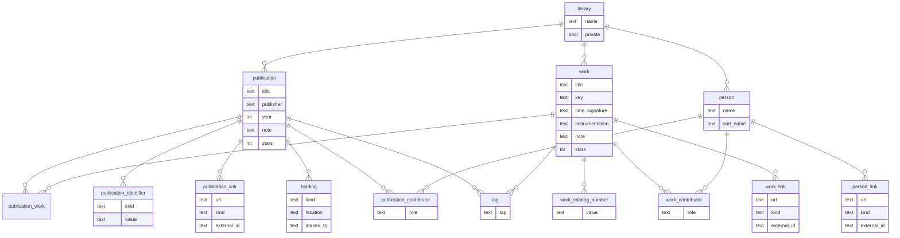

# scorarium data model

## Overview

**Libraries** contain **publications**, **works**, and **persons**. A publication is an edition, the
physical or digital thing on the shelf. A work is an individual piece that a publication contains,
and a person is anyone who contributed to a publication or a work. A **holding** is one copy of a
publication that the user owns, physical or digital. Works, persons, and holdings never exist alone.
Every work is contained in at least one publication, every person contributes to at least one
publication or work, and every publication has at least one holding.

The diagram shows the catalog tables. The `password` and `audit_entry` tables, described below,
stand apart from the catalog.



## Storage layout

Scorarium's persistent state lives in a data directory, which the application creates if it is
missing. Deployment details such as the bind address and the location of the data directory come
from command line flags and environment variables, not from a file. There are no secrets to
configure, because the login password lives in the database.

```
data/
    scorarium.db
```

`scorarium.db` is a single SQLite database containing every table in this document, for all
libraries.

## Entities

Every table has an integer primary key named `id`. The tables whose ids appear in URLs or in audit
entries (`library`, `publication`, `work`, `person`, `tag`, and the link tables) never reuse an id
after a row is deleted, so a stale link or an old audit entry cannot resolve to an unrelated row
created later. The remaining tables are reached only through their parent and let SQLite reuse ids
freely.

### library

A named container of publications.

* `id`: integer primary key
* `name`: text
* `private`: boolean, default true; hides the library and everything in it from logged-out visitors

### publication

The edition-level record. Every other catalog entity exists because a publication needs it.

* `id`: integer primary key
* `library_id`: references library
* `title`: text
* `publisher`: text, nullable
* `year`: integer, nullable
* `note`: text, nullable; freeform, edited in place, no history
* `stars`: integer 1-5, nullable; null means unrated

### publication_identifier

The numbers printed on a publication to identify it. Publications can have multiple identifiers.

* `id`: integer primary key
* `publication_id`: references publication
* `kind`: text, one of `isbn`, `ismn`, `publisher_number`, `plate_number`
* `value`: text, the normalized form

Identifiers are normalized at entry and only the normalized form is stored. `isbn` normalizes to
hyphenated ISBN-13 using the ISBN agency's range table as embedded in the `isbn` crate. `ismn`
normalizes to the hyphenated `979-0` form, expanding the legacy `M-` prefix; its registrant ranges
are fixed by the standard. `publisher_number` and `plate_number` are trimmed and uppercased. An
identifier that fails validation or whose ISBN range is not in the embedded table is rejected at
entry.

A publication cannot carry the same identifier twice, so a volume printing both its ISBN-10 and its
ISBN-13 has one row, since both normalize to the same value. Identifiers are deliberately not unique
across publications, because publishers reuse ISBNs and volumes of a set sometimes share one. The
duplicate check at import time is a lookup on `value` that warns rather than a constraint.

### work

An individual piece, such as a single nocturne or a whole sonata with all of its movements. Work
identity is resolved at import time. Entry fields suggest existing works, and imported contents
entries are matched against existing works for confirmation before new rows are created. Residual
duplicates can still arise, and a future merge operation will clean them up. Every work is contained
in at least one publication, and the deletion semantics below maintain that invariant.

* `id`: integer primary key
* `library_id`: references library
* `title`: text
* `key`: text, nullable
* `time_signature`: text, nullable
* `instrumentation`: text, nullable
* `note`: text, nullable
* `stars`: integer 1-5, nullable

### work_catalog_number

Catalog numbers a work is known by. A work can carry several (Mikrokosmos is both Sz. 107 and BB
105); most carry one; folk pieces carry none.

* `id`: integer primary key
* `work_id`: references work
* `value`: text, the number as the user typed it, trimmed

A work cannot carry the same `value` twice. The application parses each value into a scheme (`Op`,
`BWV`, `K`, `Sz`, `WoO`, ...) and a tuple of numbers, so "Op. 27 No. 2" and "Op.27/2" compare equal
and numbered collections sort in printed order. A number in an unrecognized scheme sorts after the
recognized ones and matches only on identical text. Catalog number equality is the strongest signal
when deciding whether an imported contents entry is a work the library already has. Enrichment from
metadata sources may add more numbers. There is deliberately no record of which numbers were
user-entered and which were enriched.

### publication_work

This table identifies which publications contain what works.

* `id`: integer primary key
* `library_id`: references library
* `publication_id`: references publication
* `work_id`: references work

The publication and work are referenced by composite (`id`, `library_id`) foreign keys, so the
database rejects a publication containing a work from another library. A publication contains a
given work at most once. The table carries no ordering. Contents display grouped by composer for
mixed anthologies, then sorted by parsed catalog number with title as the tie-break, and works with
no catalog number follow the numbered ones, sorted by title. This is not table-of-contents order,
but sub-numbers keep numbered collections in printed order (Mikrokosmos No. 97 is "Sz. 107/97").

### person

A composer, editor, arranger, or any other contributor. Persons are first-class entities whose
identity is resolved at import time like works: names are matched against existing persons before
new rows are created. Residual duplicates, such as "Rachmaninoff" and "Rachmaninov"
from two imports, can still arise, and the same future merge operation cleans them up.

* `id`: integer primary key
* `library_id`: references library
* `name`: text, the display form
* `sort_name`: text, the form that sorts by surname ("Satie, Erik"). It is filled at import time by
  heuristics and API lookups so the user never types the same name twice.

### publication_link, work_link, and person_link

URLs attached to a publication, work, or person. The user enters a link as a URL. When the URL
points at a record on a known external site, the application recognizes which site and which record,
and stores that alongside the URL, so the same row serves both as a link to display and as an
external identifier for enrichment. For publications, a recognized link records which source record
an import resolved to (an Open Library edition, a K10plus PPN), so enrichment can be retried without
re-searching and re-picking among editions.

* `id`: integer primary key
* `publication_id` / `work_id` / `person_id`: references the parent
* `url`: text, the link as entered
* `kind`: text, the recognized site, or `generic` for a URL the application does not recognize
* `external_id`: text, nullable; the record's identifier in the site's canonical form, present
  exactly when `kind` is not `generic`

The recognized sites are `openlibrary`, `wikidata`, `musicbrainz`, `imslp`, `viaf`, `gnd`, `isni`,
`loc`, `k10plus`, `dnb`, `harvard`, `goodreads`, `librarything`, `internetarchive`, `gutenberg`, and
`librivox`. Recognition depends on the entity kind: a Wikidata URL is recognized on any entity, but
a VIAF URL is recognized only on a person and a K10plus URL only on a publication. The set of sites
and their URL patterns are an application concern, so the database does not constrain `kind`.

An entity cannot carry the same `url` twice, nor the same recognized (`kind`, `external_id`) twice.
Two spellings of the same record's URL therefore collapse into one row. The database indexes
(`kind`, `external_id`) so that an enrichment result can be matched to the entity it belongs to.

### publication_contributor and work_contributor

These tables record who did what, on the publication ("edited by") and on the work ("composed by").
Roles are text with conventional values such as `composer`, `editor`, `arranger`, and `translator`.

* `id`: integer primary key
* `library_id`: references library
* `publication_id` / `work_id`: references the parent
* `person_id`: references person
* `role`: text

The parent and person are referenced by composite (`id`, `library_id`) foreign keys, so the database
rejects a contributor from another library. A person contributes to a given parent in a given role
at most once, but may hold several roles on the same parent, such as the composer who also edited
the edition.

### holding

One copy of a publication, physical or digital. Every publication has at least one holding. Creating
a publication creates its first holding, and deleting a publication's last holding deletes the
publication, which in turn deletes its orphaned works. Like the work-in-a-publication invariant, the
application enforces this rather than the database.

* `id`: integer primary key
* `publication_id`: references publication
* `kind`: text, CHECK one of `physical`, `digital`
* `location`: text, nullable; freeform, such as "piano bench" for a physical copy or a path for a
  digital one
* `loaned_to`: text, nullable; a name while this copy is lent out, null otherwise. It lives on the
  holding rather than the publication so that lending one of two copies is representable. It is
  mostly meaningful for physical copies, but nothing enforces that.

### tag

Plain-text tags on publications and works. There is no tag registry. The set of distinct tags in use
is the vocabulary, autocomplete suggests from it, and the user-facing concept is simply "tags". One
table holds the tags of both entity kinds so that a library's vocabulary is a single query.

* `id`: integer primary key
* `library_id`: references library
* `publication_id`: references publication, nullable
* `work_id`: references work, nullable
* `tag`: text

Exactly one of `publication_id` and `work_id` is set, and the database enforces this. The parent is
referenced by a composite (`id`, `library_id`) foreign key, so a tag's `library_id` is always the
parent's. An entity cannot carry the same tag twice. The table is indexed on (`library_id`, `tag`)
for the tag listing and autocomplete.

### password

The login password, hashed with a standard password KDF. The table holds at most one row, which the
database enforces by requiring the id to be 1. An empty table means the password is unclaimed, and
the first login sets it. The first-to-claim race is accepted for a single-user self-hosted
deployment. There is no reset flow. The operator deletes the row and claims the password again.

* `id`: integer primary key, always 1
* `password_hash`: text, the KDF output (salt and parameters included in the encoded form)

### audit_entry

A record of what changed and why, shown on the settings page so the user can see what the
application did on their behalf. Every mutation runs in a transaction that records its audit entries
before it commits, so the log and the catalog never disagree.

* `id`: integer primary key
* `created_at`: timestamp
* `source`: text, one of `user`, `orphan_cleanup`, `merge`, `link_recognition`; who or what caused
  the change
* `action`: text, one of `created`, `updated`, `deleted`, `merged`, `import_accepted`,
  `password_claimed`, `password_changed`
* `entity_kind`: text, nullable, one of `publication`, `work`, `person`, `library`
* `entity_id`: integer, nullable
* `entity_library_id`: integer, nullable
* `entity_label`: text, nullable; the entity's title or name as it read at the time, so a deleted
  entity still renders as something
* `field`: text, nullable; which field an `updated` action changed, null for every other action

The entity columns are not foreign keys. An audit entry outlives the entity it describes, which is
the point of recording the label. The password actions have no entity at all. The log is bounded:
each commit trims the table to its most recent three thousand entries.

## Access control

Visible to logged-out visitors, within a public library:

* publications, works, and persons, with their contributors, identifiers, catalog numbers, and links
* stars, on both publications and works
* the existence and kind of holdings ("one physical copy, one PDF")

Requires login:

* any and all modifications
* libraries marked `private`, along with everything they contain
* holding `location` and `loaned_to` values (shelf names, file paths, borrower names)
* tags and notes

The `private` flag lives on libraries only, and a library is private until the user says otherwise.
Within a public library, everything is visible except for the field-level rules above. All access
control is enforced by the application; the database does not care.

## Deletion semantics

This is a library of publications: publications are deleted deliberately, and everything else lives
or dies by whether a publication still needs it.

Deleting a **publication** deletes its dependent rows (identifiers, links, holdings, contributors,
tags, containment links), then garbage-collects:

* **works** no longer contained in any publication, along with everything on them (catalog numbers,
  contributors, tags, links, notes, stars)
* **persons** no longer referenced by any contributor, along with their links

Works still contained in another publication survive, as do persons still contributing anywhere.
Garbage collection is silent by design, because the user cares about publications, not orphan
management.

Deleting a publication's **last holding** deletes the publication, with everything above.

Works and persons are not deleted directly. Editing a publication's contents removes containment
links, and the same garbage collection applies. A future merge operation, not deletion, is the tool
for cleaning up duplicate works and persons.

Deleting a **library** deletes everything in it.

## Queries this model must be able to answer

The model is validated by checking the questions it exists to answer.

* **"Do I have the sheet music for this piece?"** Search matches the work by title, catalog number,
  or composer. `publication_work` lists the publications containing it,
  and their holdings say whether each is held physically, digitally, or both.
* **"What is in this volume?"** `publication_work` lists the publication's works, sorted by catalog
  number.
* **"What do I own by this composer?"** Resolve the name to a person, then follow
  `work_contributor` and `publication_contributor` to their works and publications.
* **"Where is my copy?"** The publication's holdings carry `location` values (logged in).
* **"What did I tag 'christmas'?"** The tag table lists publications and works together (logged in).
* **"Is this volume in my library already?"** Normalize the number in hand and look it up in
  `publication_identifier.value`, falling back to a title search.
* **"Who did I lend it to?"** Join holdings with a non-null `loaned_to` to their publications
  (logged in).
